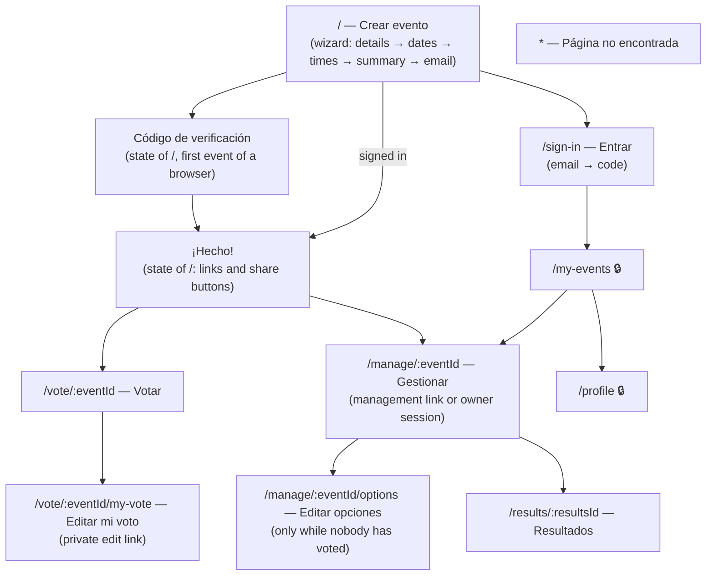

# qando — Sitemap

Every view has its own URL and can be opened directly (deep link). Paths are in English, like the code; the UI texts live in separate translation catalogues (`es.json` in v1, `en.json` later), so the paths do not change with the language. Views marked **private** need a session; the others are opened with a capability link (see *What each link allows* in `user-stories.md`) or by anyone.

## Map

## Routes

| Route | View | Access | States |
|---|---|---|---|
| `/` | Create an event (wizard), code screen, "¡Hecho!" | Public; creating needs a verified email (code or session) | Wizard steps, code sent, wrong/expired code, done |
| `/sign-in` | Sign in: email, then code | Public | Code sent, wrong/expired code; returns to the page that asked for it |
| `/my-events` | List of my events (title, state, deadline) | **Private** | Loading, empty ("Aún no has creado ningún evento"), error, list |
| `/profile` | Profile: name (editable), email (read-only) | **Private** | Loading, error, saved |
| `/vote/:eventId` | Voting page | Participation link | Open (vote or edit own vote), closed, confirmed, cancelled, not found, could not load |
| `/vote/:eventId/my-vote` | Edit my vote from another browser | Participation link + vote-edit token | As above, opened on the voter's answers |
| `/results/:resultsId` | Results | Results link, management link or owner session | No votes, provisional, final, confirmed, cancelled, not found |
| `/manage/:eventId` | Management page: links, deadline (extend, close), confirm a date, email states and retry, cancel | Management link or owner session | Open, closed (pending confirmation), confirmed, cancelled, access refused |
| `/manage/:eventId/options` | Edit options (the wizard on the dates and times steps) | Management link or owner session; only while nobody has voted | Editing, rejected because a vote arrived |
| `*` | Page not found | Public | — |

Confirming a date, cancelling and closing voting are dialogs on the management page, not separate routes.

## How the links carry their tokens

| Link | Example | Why |
|---|---|---|
| Participation | `/vote/k3Jd9…` | The event ID is itself the unguessable token; it stays in the address bar so participants can share it again. |
| Results | `/results/Qw7p2…` | Its own unguessable ID, different from the event ID. The organizer may share it, so it stays visible. |
| Management | `/manage/k3Jd9…#t=Zx81…` | The management token goes in the fragment (`#t=`): browsers never send it to a server, so it does not appear in logs or referrers. The app stores it for that event, removes it from the address bar and sends it in a request header. |
| Vote edit | `/vote/k3Jd9…/my-vote#t=Hy4m…` | Same as management. |

The event ID alone in `/manage/:eventId` grants nothing: without a stored management token or the owner's session the page shows "No tienes acceso a este evento".

## Guards

- **Private routes** (`/my-events`, `/profile`): without a session they redirect to `/sign-in` and continue to the requested page after sign-in.
- **Management routes:** the page loads only if the API accepts the stored management token or the session; otherwise it shows the access-refused state. The API repeats the check on every request.
- **Edit options:** if the event has votes, the route returns to the management page with the explanation.
