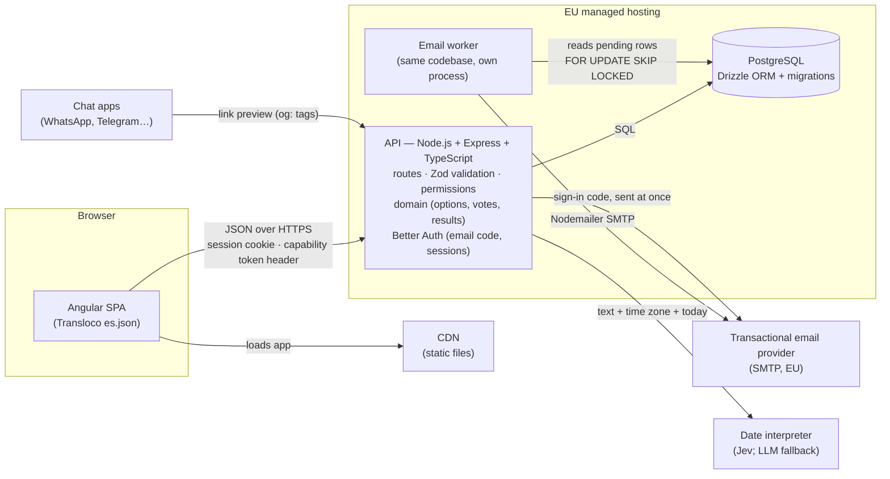
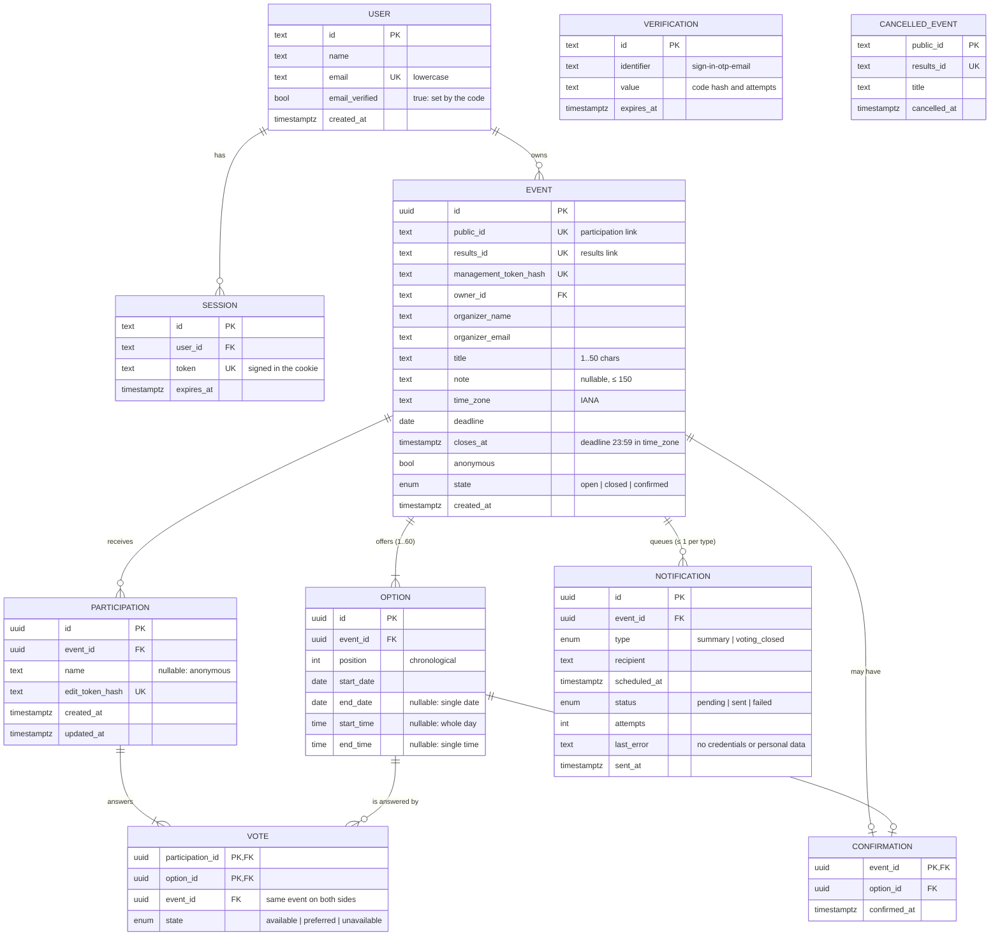
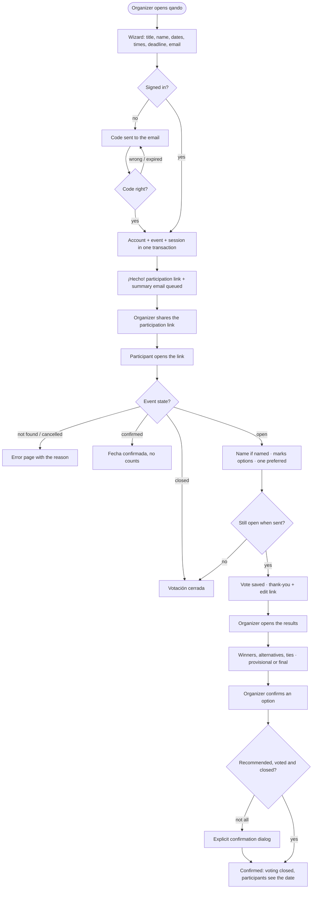
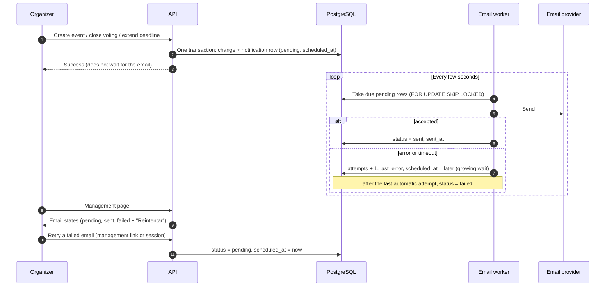

# qando — Diagrams

Four diagrams, each answering one question. They are written in Mermaid, so GitHub renders them and they change with the code.

1. [Architecture](#1-architecture): which parts run where, and how they talk.
2. [Entity-relationship](#2-entity-relationship): what is stored, with keys, relations and constraints.
3. [Main flow](#3-main-flow): create → share → vote → results → confirm, with the relevant errors.
4. [Email flow](#4-email-flow): how an email goes from a trigger to the inbox, and what happens when it fails.

## 1. Architecture

| Part | Responsibility | Notes |
|---|---|---|
| Angular SPA | Views, routing, guards, forms; typed API client generated from the contract | Served as static files by the CDN. Never holds secrets. |
| API | Every validation and permission check; domain logic; sessions; capability tokens | One Express app. Zod schemas in a shared `contracts` package are the single source for validation, types and the OpenAPI document (Swagger UI). |
| Email worker | Sends the queued emails (summary, voting closed), retries with growing waits | Separate process so a slow SMTP server never delays an API request. Restarts resume the queue. |
| PostgreSQL | Users, sessions, events, options, votes, confirmations, the email queue | Every compound operation runs in one transaction. |
| Email provider | Delivers email over SMTP | Scaleway Transactional Email (EU), STARTTLS on port 587; a test SMTP server in the tests. |
| Date interpreter | Turns plain-language text into date candidates | Called only by the API, behind a `DateInterpreter` interface; answers are validated with the same rules as manual dates. |

The hosting provider is chosen by comparing costs; the decisions and the deployment configuration are in the technical decisions document.

## 2. Entity-relationship

`VERIFICATION` (sign-in codes) and `CANCELLED_EVENT` (tombstones) have no relations: a code belongs to an email that may have no account yet, and a tombstone outlives the event it replaces.

**Constraints**

| Table | Constraint | Why |
|---|---|---|
| EVENT | `public_id`, `results_id`: ≥ 128 random bits, unique | Capability links that cannot be guessed. They are kept in clear because the management page shows them again; the management token is only stored as a hash. |
| EVENT | `owner_id` NOT NULL | Every event belongs to a verified account. Added with sign-up (HU01), in the same migration as the `USER` table: the events stored before it (by the seed script) got the verified account of their organizer email, and the seed script creates that account from then on. |
| USER | `email` unique | One account per email; Better Auth stores it lowercase. |
| SESSION | `token` unique, `ON DELETE CASCADE` from `USER` | The cookie carries the token signed with the server's secret, so the stored token alone does not open a session. |
| OPTION | `end_date > start_date` when set; `end_time > start_time` when set; times only when `end_date` is null; unique (`event_id`, `start_date`, `end_date`, `start_time`, `end_time`) with nulls not distinct; unique (`event_id`, `position`) | No degenerate ranges, times only on single dates, no exact duplicates (a whole day twice counts as a duplicate), one option per position. |
| OPTION | At most 60 per event, dates at most 12 months ahead | Checked by the API in the same transaction (a row count is not a column constraint). |
| VOTE | Composite FKs (`participation_id`, `event_id`) and (`option_id`, `event_id`) | A vote can never point at an option of another event. |
| VOTE | Partial unique index: one `preferred` per participation | At most one preferred option. |
| — | Text lengths (title, note, names) | Not a column check: lengths count characters as people see them (graphemes), which only the domain does; the API validates them before writing. |
| CONFIRMATION | Primary key `event_id` | A confirmation is final: a second one is impossible. |
| NOTIFICATION | Unique (`event_id`, `type`) | One summary and one "voting closed" email per event: retries and restarts never create duplicates. |

**Deletion policy (cancelling an event).** One transaction inserts the `CANCELLED_EVENT` row and deletes the `EVENT`. Options, participations, votes, the confirmation and its notifications go with it (`ON DELETE CASCADE`). Deleting a user is not offered in v1 (`EVENT.owner_id` is `ON DELETE RESTRICT`).

**Correspondence with the storage.** Each entity is one PostgreSQL table, defined in Drizzle and created by versioned migrations. `USER`, `SESSION` and `VERIFICATION` are Better Auth's tables through its Drizzle adapter: their exact columns follow the library, and only the fields that matter here are shown. Better Auth also needs an `accounts` table (other ways to prove identity, such as passwords or social sign-in), which qando leaves empty.

## 3. Main flow

## 4. Email flow

| Email | Trigger | Recipient | Rescheduled or removed when |
|---|---|---|---|
| Summary | Event created | Organizer email | Removed if the event is cancelled before it is sent |
| Voting closed | `closes_at` reached, or the organizer closes voting early (scheduled for now) | Organizer email | Rescheduled when the deadline is extended; removed when a date is confirmed before it is sent, or the event is cancelled |

The sign-in code email is the only one outside the queue: the organizer is waiting for it on screen, so the API sends it at once and shows a failure there with "Reenviar código". A row marked `sent` is never sent again, and the unique (`event_id`, `type`) index stops a second row. Delivery is *at least once*: if the worker dies in the instant between the provider accepting an email and the row being marked `sent`, that one email can go out twice after the restart. This window is accepted; it cannot be closed with SMTP. SMTP acceptance does not prove the email reached the inbox; the management page says "enviado", not "recibido".
